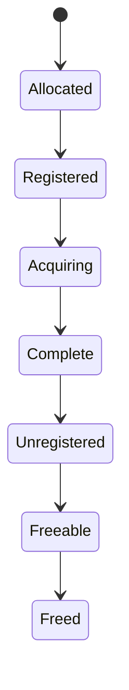

# Understanding Complex Systems
## From shared state to agreement

**A practical course in concurrency, versioning, and systems under failure**  
Revision 0.2 · Consolidated 16 October 2026

This course follows a chain of experiments: observe a failure, identify the
assumption it violates, repair that boundary, and ask what the repair still
cannot guarantee. The programs are small enough to inspect completely. The
questions scale from CPU threads to database transactions and replica voting.

The central question throughout is:

> What evidence makes it safe to accept this observation or state transition?

### Scope and provenance

This edition consolidates the course in its actual order:

1. [Systems Under Failure](https://chatgpt.com/share/6ad237fa-06b8-83ea-bd34-5c56a9008446):
   the original goals, counter race, mutex scope, CAS, spinlocks, cache
   coherence, semaphore relay, memory and isolation boundaries, ownership,
   publication, and inventory exercises.
2. [Concurrency progression review](https://chatgpt.com/share/6ad230da-b864-83ea-8164-2d92a0237cbc):
   the continuation through versioning, databases, reservation experiments,
   snapshots, and the final unfinished split-vote challenge.

Repetition has been condensed, but the important questions, failed attempts,
and corrections remain. Complete teaching programs appear inline. Where a
program is reconstructed or edited for compact formatting, portability,
clearer experiments, or validation, that treatment is identified. The
companion archive retains extracted source text, original example blocks,
runnable programs, validation results, and the continuation checkpoint.

The manuscript distinguishes code that was introduced or explained from
experiments the learner actually reported running. New validation runs are
separate evidence. Uploaded screenshots and attached files were not silently
turned into datasets. Unresolved historical diagnoses remain unresolved.

This is a working course manuscript; no public release or open-source license
is implied by its creation. Future distributed implementations and formal
models named in the initial plan remain future work.

## Contents

1. [Correctness under assumptions](#1-correctness-under-assumptions)
2. [Lab: the counter and the lock that was not shared](#2-lab-the-counter-and-the-lock-that-was-not-shared)
3. [Lab: compare-and-swap and the unexpected winner](#3-lab-compare-and-swap-and-the-unexpected-winner)
4. [Lab: building mutual exclusion from an atomic primitive](#4-lab-building-mutual-exclusion-from-an-atomic-primitive)
5. [Lab: correct programs can still fight over a cache line](#5-lab-correct-programs-can-still-fight-over-a-cache-line)
6. [Lab: a semaphore baton and a finish barrier](#6-lab-a-semaphore-baton-and-a-finish-barrier)
7. [Why memory and isolation have several different boundaries](#7-why-memory-and-isolation-have-several-different-boundaries)
8. [Ownership, lifetime, and the camera/MEX case study](#8-ownership-lifetime-and-the-cameramex-case-study)
9. [Lab: publishing ordinary data with acquire/release](#9-lab-publishing-ordinary-data-with-acquirerelease)
10. [Lab: atomic inventory operations, non-atomic decisions](#10-lab-atomic-inventory-operations-non-atomic-decisions)
11. [Immutability moves coordination to publication](#11-immutability-moves-coordination-to-publication)
12. [Database transactions and stale decisions](#12-database-transactions-and-stale-decisions)
13. [Lab: one seat, two buyers](#13-lab-one-seat-two-buyers)
14. [Lab: many uniquely numbered tickets](#14-lab-many-uniquely-numbered-tickets)
15. [Correct executions and state machines](#15-correct-executions-and-state-machines)
16. [Lab: consistent snapshots of multiple fields](#16-lab-consistent-snapshots-of-multiple-fields)
17. [When the validation protocol cannot be trusted](#17-when-the-validation-protocol-cannot-be-trusted)
18. [Lab: conflicting proposals and accidental double voting](#18-lab-conflicting-proposals-and-accidental-double-voting)
19. [Repairing the right critical section](#19-repairing-the-right-critical-section)
20. [Safety without progress](#20-safety-without-progress)
21. [Where this edition stops](#21-where-this-edition-stops)

## Using the programs

Use Linux or WSL with a C11 compiler and POSIX threads. The examples use
`pthread_barrier_t` and unnamed POSIX semaphores, which are not available in
every environment that provides pthreads. There are eighteen standalone C
files in the companion archive, and each appears in full in this document.

Save a listing under its displayed filename, then compile it with:

```bash
gcc -std=c11 -O2 -Wall -Wextra -pthread example.c -o example
./example
```

The initial undefined-counter demonstration suggests `-O0` to inspect the
symptom; changing optimization does not repair its C data race. Clearly
labeled broken examples are part of the learning progression.

The listings focus on the synchronization argument and generally assume
successful initialization, thread creation, and synchronization calls. They
are teaching programs rather than complete application scaffolding. The
semaphore relay explicitly handles interrupted waits because proceeding
without obtaining the permit would invalidate its ordering argument.

Before running a lab, write down its invariant. After running it, explain why
the mechanism preserves or violates that invariant. A successful run is an
observation; the reasoning must cover other permitted schedules too.

## 1. Correctness under assumptions

The course began with a precise goal: understand how systems remain correct,
safe, or recoverable when their assumptions fail. Concurrency, consensus,
security, and formal methods are different settings for that same inquiry.

An **execution** is a sequence of state transitions. A concurrent program
admits many executions because thread operations can overlap and interleave.
Correctness has to cover every execution permitted by the model, including
ones that never appeared in the few runs we observed.

An **invariant** must hold throughout the relevant execution or observation
boundary. A **postcondition** is required after an operation or computation
finishes. For a counter, `counter == 2 * ITERATIONS` after both workers join
is a postcondition; it is not something that should hold throughout their
loops. Always specify when a relationship must be observable as true.

| Term | Question to ask |
| --- | --- |
| State | What information affects the next decision? |
| Transition | What change is being attempted? |
| Invariant | What must remain true at the specified boundary? |
| Safety | What bad outcome must never be accepted? |
| Liveness | What useful outcome must eventually occur, under which assumptions? |
| Atomicity | Exactly which operation is indivisible to the relevant observers? |
| Ownership | Who has permission to access or change this state? |
| Evidence | What establishes that a decision is justified? |

“Atomic” does not mean one clock cycle, nor does it make surrounding code
atomic. Its boundary could be an increment, a conditional claim, or a larger
operation implemented by a protocol.

### The recurring lesson template

For each experiment, record:

1. **Invariant:** the property and its observation boundary.
2. **Mechanism:** the rule intended to preserve it.
3. **Assumptions:** participant behavior and environmental guarantees.
4. **Failure:** the execution that violates an assumption or property.
5. **Detection:** what evidence exposes the failure, and what remains uncertain.
6. **Containment:** what prevents one failure from spreading.
7. **Recovery:** how the system returns to useful valid operation.
8. **Adversarial angle:** whether timing or another assumption can be manipulated.
9. **Lesson:** what the next design must establish explicitly.

The initial roadmap included independent replicated processes, crash recovery,
network partitions, Raft, Byzantine protocols, model checking, and fault
injection. Those remain a roadmap, not claims of completed implementations.
This edition covers the actual C progression and its connections through the
one-slot replica simulator and the unfinished split-vote exercise.

## 2. Lab: the counter and the lock that was not shared

Two workers each increment a counter one million times. After both finish,
the intended result is two million.

A source-level `counter++` looks like one action, but a useful conceptual
breakdown is read, compute, then write. Both workers can read the same old
value and overwrite one another's result.

| Step | Worker A | Worker B |
| --- | --- | --- |
| Read | Sees 0 | Sees 0 |
| Compute | Computes 1 | Computes 1 |
| Write | Stores 1 | Stores 1 |

This is an explanatory failure trace, not a complete specification of the
broken C program. Ordinary unsynchronized conflicting accesses create a
**C data race**, which causes undefined behavior. C does not promise merely
a smaller final count.

A broader **race condition** is a timing-dependent logical failure; one can
exist even when all individual accesses use atomics. A nondeterministic
winner, by itself, need not be a bug.

### The initial program — intentionally undefined

**Edited source listing — `counter_racy.c`:** compact formatting and an
explicit unused-argument annotation; the deliberate data race remains.

```c
#include <pthread.h>
#include <stdio.h>

#ifndef ITERATIONS
#define ITERATIONS 1000000L
#endif

long counter = 0;

void *worker(void *arg) {
    (void)arg;
    for (long i = 0; i < ITERATIONS; i++) {
        counter++;
    }
    return NULL;
}

int main(void) {
    pthread_t a, b;
    pthread_create(&a, NULL, worker, NULL);
    pthread_create(&b, NULL, worker, NULL);
    pthread_join(a, NULL);
    pthread_join(b, NULL);
    printf("expected=%ld actual=%ld\n", 2L * ITERATIONS, counter);
    return 0;
}
```

Compile this particular demonstration with `-O0` first:

```bash
gcc -std=c11 -O0 -Wall -Wextra -pthread counter_racy.c -o counter_racy
./counter_racy
```

A wrong total exposes a symptom. A correct total does not establish safety.
Changing optimization may dramatically alter the symptom because the
program already has undefined behavior. `volatile` is not a repair.

### The first attempted repair: one private mutex per worker

The learner correctly suspected the lock's scope when their mutex version
still failed. A mutex declared inside `worker` is a different object in each
invocation. Both workers can own their respective locks simultaneously.

**Deliberately broken reconstruction — `counter_private_mutex.c`:**

```c
#include <pthread.h>
#include <stdio.h>

#ifndef ITERATIONS
#define ITERATIONS 1000000L
#endif

long counter = 0;

void *worker(void *arg) {
    (void)arg;
    pthread_mutex_t lock = PTHREAD_MUTEX_INITIALIZER; // Different object per worker
    for (long i = 0; i < ITERATIONS; i++) {
        pthread_mutex_lock(&lock);
        counter++; // Still a data race: workers use different locks
        pthread_mutex_unlock(&lock);
    }
    pthread_mutex_destroy(&lock);
    return NULL;
}

int main(void) {
    pthread_t a, b;
    pthread_create(&a, NULL, worker, NULL);
    pthread_create(&b, NULL, worker, NULL);
    pthread_join(a, NULL);
    pthread_join(b, NULL);
    printf("expected=%ld actual=%ld\n", 2L * ITERATIONS, counter);
    return 0;
}
```

The shared resource is the counter, but there is no common coordination
object. Each worker has protected itself from itself. This example still
has undefined behavior; the presence of mutex calls is not enough.

### Correct repair A: one shared mutex

**Edited source listing — `counter_mutex.c`:**

```c
#include <pthread.h>
#include <stdio.h>

#ifndef ITERATIONS
#define ITERATIONS 1000000L
#endif

long counter = 0;
pthread_mutex_t lock = PTHREAD_MUTEX_INITIALIZER;

void *worker(void *arg) {
    (void)arg;
    for (long i = 0; i < ITERATIONS; i++) {
        pthread_mutex_lock(&lock);
        counter++;
        pthread_mutex_unlock(&lock);
    }
    return NULL;
}

int main(void) {
    pthread_t a, b;
    pthread_create(&a, NULL, worker, NULL);
    pthread_create(&b, NULL, worker, NULL);
    pthread_join(a, NULL);
    pthread_join(b, NULL);
    printf("expected=%ld actual=%ld\n", 2L * ITERATIONS, counter);
    pthread_mutex_destroy(&lock);
    return 0;
}
```

This does not require the counter itself to be atomic. All concurrent
accesses to it occur under the same mutex, and main reads it after both joins.
The mutex supplies mutual exclusion and the necessary synchronization.

### Correct repair B: an atomic read-modify-write

**Consolidated source listing — `counter_atomic.c`:**

```c
#include <stdatomic.h>
#include <pthread.h>
#include <stdio.h>

#ifndef ITERATIONS
#define ITERATIONS 1000000L
#endif

atomic_long counter = 0;

void *worker(void *arg) {
    (void)arg;
    for (long i = 0; i < ITERATIONS; i++) {
        atomic_fetch_add(&counter, 1);
    }
    return NULL;
}

int main(void) {
    pthread_t a, b;
    pthread_create(&a, NULL, worker, NULL);
    pthread_create(&b, NULL, worker, NULL);
    pthread_join(a, NULL);
    pthread_join(b, NULL);
    printf("expected=%ld actual=%ld\n", 2L * ITERATIONS, atomic_load(&counter));
    return 0;
}
```

`atomic_fetch_add` makes the increment an indivisible read-modify-write on
that object. It does not lock an arbitrary surrounding region of code.

**What changed?** The mutex version protects an agreed critical section;
the atomic version gives the particular increment its required semantics.
Both can preserve the same final-count property.

**Try:** identify which object is shared in each listing. Explain why moving
a mutex declaration changes correctness while changing a variable's cache-line
placement, by itself, does not repair this race.

## 3. Lab: compare-and-swap and the unexpected winner

CAS stands for **compare-and-swap**; the C API calls it compare-and-exchange.
It makes the comparison and conditional replacement one atomic operation.

For strong CAS, the conceptual rule is:

| Comparison | Effect on object | Return | Effect on `expected` |
| --- | --- | --- | --- |
| Object equals expected | Replaced with desired | Success | Retains the matching expected value |
| Object differs | Unchanged by this attempt | Failure | Updated with the observed object value |

Let two workers try to change a slot from 0 to their own nonzero ID.

**Edited source listing — `cas_claim.c`:**

```c
#include <pthread.h>
#include <stdatomic.h>
#include <stdio.h>

atomic_int slot = 0;

void *worker(void *arg) {
    int id = *(int *)arg;
    int expected = 0;
    if (atomic_compare_exchange_strong(&slot, &expected, id))
        printf("Thread %d CLAIMED the slot\n", id);
    else
        printf("Thread %d LOST; observed owner %d\n", id, expected);
    return NULL;
}

int main(void) {
    pthread_t a, b;
    int id_a = 1, id_b = 2;
    pthread_create(&a, NULL, worker, &id_a);
    pthread_create(&b, NULL, worker, &id_b);
    pthread_join(a, NULL);
    pthread_join(b, NULL);
    printf("Final slot owner: %d\n", atomic_load(&slot));
    return 0;
}
```

Exactly one successful claim is possible in this one-shot example. Once one
worker replaces 0, the other's comparison against 0 fails. The loser learns
the owner observed by the failed comparison.

### “How can thread 2 ever get the slot?”

Creating thread A first does not require A to reach the claim first. Thread
creation order is not execution order. A may be ready while B runs; A may
also run and be paused before the CAS.

The guarantee is one owner, not a predetermined owner. Scheduler
nondeterminism is compatible with correctness.

The source experimented with delays to make another winner easier to see.
An empty delay loop may disappear under optimization. A sleep or extra
logging changes the experiment's schedule; neither is a proof of an ordering
constraint unless the program uses an appropriate synchronization mechanism.

### Weak and strong do not mean weaker and stronger correctness

Strong CAS does not spuriously fail when its comparison matches. Weak CAS
may fail spuriously, so it is normally used where the algorithm already
retries. Failure still reports an observed value through `expected`.

A lock-acquisition loop must restore the expected unlocked value on every
attempt:

```c
for (;;) {
    int expected = 0;
    if (atomic_compare_exchange_weak(&locked, &expected, 1))
        break;
}
```

If a failed attempt changes `expected` to 1 and the next attempt uses that
value without resetting it, a `1 → 1` success could be mistaken for acquiring
an already-owned lock. The surrounding protocol matters as much as the
primitive.

On the x86 examples discussed, weak and strong could compile to the same
`lock cmpxchg` instruction. On other implementations the compiler may need
to hide hardware retries for strong CAS. The API contract is portable; a
particular instruction mapping is an implementation detail.

### The assembly connection

For an illustrative x86 `cmpxchg`, the accumulator supplies the expected
value, another operand supplies the desired replacement, and the flags
report whether the comparison succeeded. `sete` can turn that flag into a
Boolean. A `lock` prefix on the memory read-modify-write supplies the relevant
cross-core atomicity; it is not a pthread mutex or a command to stop every
other processor.

Inspect your actual compiler's output:

```bash
gcc -std=c11 -O2 -pthread -S -masm=intel cas_claim.c -o cas_claim.s
```

**Try:** draw the two valid winning histories, then explain why both
successful `0 → ID` transitions cannot occur without an intervening reset.

## 4. Lab: building mutual exclusion from an atomic primitive

The next realization was that atomics and mutexes are not unrelated choices.
An atomic operation can establish who owns a lock; the ownership protocol
then protects a much larger region of ordinary code.

C's `atomic_flag_test_and_set` returns the previous flag value while setting
it to true. Observing false means this caller acquired an unowned flag.
Observing true means it must keep waiting.

**Edited source listing — `spin_counter.c`:**

```c
#include <pthread.h>
#include <stdatomic.h>
#include <stdio.h>

#ifndef ITERATIONS
#define ITERATIONS 1000000L
#endif

long counter = 0;
atomic_flag lock = ATOMIC_FLAG_INIT;

void spin_lock(void) {
    while (atomic_flag_test_and_set(&lock)) {
        // Busy wait
    }
}

void spin_unlock(void) {
    atomic_flag_clear(&lock);
}

void *worker(void *arg) {
    (void)arg;
    for (long i = 0; i < ITERATIONS; i++) {
        spin_lock();
        counter++;
        spin_unlock();
    }
    return NULL;
}

int main(void) {
    pthread_t a, b;
    pthread_create(&a, NULL, worker, NULL);
    pthread_create(&b, NULL, worker, NULL);
    pthread_join(a, NULL);
    pthread_join(b, NULL);
    printf("expected=%ld actual=%ld\n", 2L * ITERATIONS, counter);
    return 0;
}
```

The flag operations here use their default sequentially consistent ordering.
They provide the ordering needed for the protected ordinary counter; a
relaxed flag-only replacement would not establish the same protection for
surrounding non-atomic data.

### “How would the spinlock be done using a mutex?”

The spinlock is itself a lock implementation. A pthread mutex is another
mechanism for establishing mutually exclusive access. You would normally
replace the homemade spinlock with a mutex rather than wrap one in the other.

| Mechanism | What a losing participant does | Scope of the guarantee |
| --- | --- | --- |
| Atomic increment | Completes its own increment according to atomic semantics | That object operation |
| CAS claim | Receives failure and follows the algorithm's policy | Conditional object transition |
| Simple spinlock | Actively retries lock acquisition | Critical section followed by all participants |
| Pthread mutex | May block under contention; implementation may also spin | Critical section followed by all participants |

Making the protected region longer can preserve the final count while
wasting much more CPU on spinning. A lock owner that stops progressing can
leave waiters stuck. This simple spinlock promises neither fairness nor a
bounded waiting time.

**The useful hierarchy:** an atomic ownership transition supports a lock
protocol, which protects a critical section and the invariant maintained
inside it. An ordinary `long` is safe because of that protocol, not because
its source-level increment became inherently atomic.

## 5. Lab: correct programs can still fight over a cache line

The next experiment moved below C variables into physical memory behavior.
Two threads can update different atomic objects correctly while contending
on the same cache-coherence unit.

A cache line is a block tracked by the cache/coherence machinery. The course
used an assumed 64-byte line environment. Sixty-four is a hardware assumption
for this experiment, not a rule of C.

Very roughly, a coherence protocol lets multiple cores retain readable
copies but coordinates ownership for conflicting writes. MESI names four
states: Modified, Exclusive, Shared, Invalid. These are a useful model;
real implementations include additional machinery and variations.

The important boundary mismatch is:

| C algorithm sees | Hardware may see |
| --- | --- |
| Worker A owns counter A | Both counters occupy one cache line |
| Worker B owns counter B | Both writers repeatedly need that line |

This is **false sharing**: logically independent writes contend because of
layout. Updating the exact same counter is true sharing. Neither label
implies that atomic operations stop being correct.

**Edited source benchmark — `false_sharing.c`:** preserves the three cases,
uses compact calls, adds result/layout checks, and defaults to fewer iterations.
The original display code subtracted pointers to distinct subobjects; this
listing reports standard `offsetof` values instead of relying on that pointer
subtraction.

```c
#define _POSIX_C_SOURCE 200809L
#include <assert.h>
#include <pthread.h>
#include <stdatomic.h>
#include <stddef.h>
#include <stdio.h>
#include <time.h>

#ifndef ITERATIONS
#define ITERATIONS 10000000L
#endif
#define CACHE_LINE 64

_Alignas(CACHE_LINE) atomic_long shared_counter = 0;
struct Together {
    _Alignas(CACHE_LINE) atomic_long a;
    atomic_long b;
} together;
struct Apart {
    _Alignas(CACHE_LINE) atomic_long a;
    _Alignas(CACHE_LINE) atomic_long b;
} apart;

_Static_assert(offsetof(struct Together, b) + sizeof(atomic_long) <= CACHE_LINE, "Together must fit within 64 bytes");
_Static_assert(offsetof(struct Apart, b) >= CACHE_LINE, "Apart needs separate assumed lines");

void *worker(void *arg) {
    atomic_long *counter = arg;
    for (long i = 0; i < ITERATIONS; i++)
        atomic_fetch_add_explicit(counter, 1, memory_order_relaxed);
    return NULL;
}

double now(void) {
    struct timespec ts;
    clock_gettime(CLOCK_MONOTONIC, &ts);
    return ts.tv_sec + ts.tv_nsec / 1e9;
}

void run(const char *label, atomic_long *a, atomic_long *b) {
    pthread_t ta, tb;
    atomic_store(a, 0);
    if (a != b) atomic_store(b, 0);
    double start = now();
    pthread_create(&ta, NULL, worker, a);
    pthread_create(&tb, NULL, worker, b);
    pthread_join(ta, NULL);
    pthread_join(tb, NULL);
    double elapsed = now() - start;
    long ca = atomic_load(a), cb = atomic_load(b);
    assert(ca == (a == b ? 2L * ITERATIONS : ITERATIONS));
    assert(cb == (a == b ? 2L * ITERATIONS : ITERATIONS));
    printf("%s: A=%ld B=%ld seconds=%.6f addresses=%p,%p\n", label, ca, cb, elapsed, (void *)a, (void *)b);
}

int main(void) {
    printf("member offsets: together=%zu apart=%zu assumed_line=%d\n", offsetof(struct Together, b), offsetof(struct Apart, b), CACHE_LINE);
    run("same atomic", &shared_counter, &shared_counter);
    run("false sharing", &together.a, &together.b);
    run("separate lines", &apart.a, &apart.b);
    return 0;
}
```

All three cases must produce the correct counts. The false-sharing and
separate-line cases perform the same kind of per-object atomic increment.
Their arrangement changes the expected coherence traffic.

`_Alignas(64)` requests a 64-byte boundary. The structure layout and static
checks establish the intended relative placement for this build. They do
not query the running processor's cache-line size.

### What the experiment can establish

A large timing difference is consistent with the cache-contention mechanism,
but one timing run is not a direct trace of coherence states. Core placement,
shared versus separate physical cores, optimization, frequency changes,
other workloads, and thread startup affect the result. Affinity or supported
hardware performance counters can make a more controlled follow-up.

Putting `printf` in the hot loop can dominate the operation being studied.
The library may synchronize internally, while I/O perturbs scheduling and
cache state. Print results after the measured work when investigating the
increment cost. The source's surprising per-thread progress output was a
lesson about instrumentation as well as scheduling.

### Why not make every coherence unit tiny?

Cache-line size is an engineering tradeoff. Tracking larger blocks can
reduce metadata and exploit spatial locality; it also couples unrelated
nearby writes. False sharing exposes where the nearby-access assumption
fails for this workload. Padding every object has its own memory costs.

**Try:** confirm the reported offsets, then compare counts and time as
separate questions. Explain why moving the counters changes performance
without changing the correctness argument.

## 6. Lab: a semaphore baton and a finish barrier

The learner then asked for a stronger rule: A increments, then B, then A,
then B. A mutex permits one owner at a time, but generally does not choose
which waiting thread becomes the next owner.

Two semaphores can encode permission to proceed. A starts with one permit;
B starts with zero. Each worker consumes its permit, touches the ordinary
counter, then posts the other worker's permit.

**Consolidated source listing — `thread_relay.c`:** uses the corrected barrier
API, compact formatting, and retries `sem_wait` when interrupted by a signal.

```c
#define _POSIX_C_SOURCE 200809L
#include <errno.h>
#include <pthread.h>
#include <semaphore.h>
#include <stdio.h>
#include <stdlib.h>

#define TURNS 10
long counter = 0;
sem_t turn_a, turn_b;
pthread_barrier_t finish_line;

void wait_turn(sem_t *turn) {
    while (sem_wait(turn) == -1) {
        if (errno == EINTR) continue;
        perror("sem_wait");
        exit(EXIT_FAILURE);
    }
}

void *worker_a(void *arg) {
    (void)arg;
    for (int i = 0; i < TURNS; i++) {
        wait_turn(&turn_a);
        printf("A: %ld\n", ++counter);
        sem_post(&turn_b);
    }
    puts("A reached finish barrier");
    pthread_barrier_wait(&finish_line);
    puts("A exits");
    return NULL;
}

void *worker_b(void *arg) {
    (void)arg;
    for (int i = 0; i < TURNS; i++) {
        wait_turn(&turn_b);
        printf("B: %ld\n", ++counter);
        sem_post(&turn_a);
    }
    puts("B reached finish barrier");
    pthread_barrier_wait(&finish_line);
    puts("B exits");
    return NULL;
}

int main(void) {
    pthread_t a, b;
    sem_init(&turn_a, 0, 1);
    sem_init(&turn_b, 0, 0);
    pthread_barrier_init(&finish_line, NULL, 2);
    pthread_create(&a, NULL, worker_a, NULL);
    pthread_create(&b, NULL, worker_b, NULL);
    pthread_join(a, NULL);
    pthread_join(b, NULL);
    printf("Final counter: %ld\n", counter);
    sem_destroy(&turn_a);
    sem_destroy(&turn_b);
    pthread_barrier_destroy(&finish_line);
    return 0;
}
```

The increment lines alternate `A: 1`, `B: 2`, through `B: 20`. The ordinary
counter is safe because the handoff orders its accesses. No atomic counter
or additional mutex is necessary for this protocol.

The finish barrier establishes that neither worker proceeds past that phase
until both have arrived. It does not make their next CPU instructions execute
at the same instant, and it does not specify the order of their exit messages.
After A posts B's last permit, B may even reach the finish barrier before A
prints its own arrival message.

### The compiler error was an API distinction

An earlier attempted listing used `pthread_cond_wait` with a barrier object.
The correction was `pthread_barrier_wait(&finish_line)`. A condition variable
is a different mechanism; its wait operation also needs an associated mutex.
The mismatch did not indicate a flaw in semaphore handoff.

| Primitive | Rule expressed |
| --- | --- |
| Atomic operation | This particular object transition is indivisible |
| Mutex | One participating owner may execute the protected region |
| Semaphore | A count of permits/events controls progress |
| Two-semaphore baton | Permission is handed to a particular next participant |
| Barrier | A phase cannot finish until all required participants arrive |

These mechanisms constrain legal histories. They do not prescribe a complete
scheduler timeline. If a participant never reaches a required barrier, the
others can wait indefinitely; correct participant counts and reachable phases
are part of the assumptions.

**Try:** explain why replacing the baton with an ordinary shared counter
and two unconstrained loops loses the alternation guarantee even if the
counter itself becomes atomic.

## 7. Why memory and isolation have several different boundaries

The cache example prompted a broader question: if C code can reach ordinary
memory so directly, what makes process, container, and VM boundaries real?

The answer requires distinguishing the units that different mechanisms track.

| Layer or mechanism | Relevant unit or responsibility |
| --- | --- |
| C object model | Object lifetime, type, bounds, and valid operations |
| Allocator | Allocated/free chunks and allocator metadata |
| Cache coherence | Cache lines and cross-core visibility/ownership |
| Virtual memory | Page mappings and access permissions |
| Kernel | Processes, credentials, resources, namespaces, and policy |
| Virtualization | Guest execution and guest-to-host memory/resource boundaries |

`malloc` metadata does not normally cause the processor to check an object's
allocation bounds on every pointer dereference. An invalid C access can be
undefined behavior while landing in a mapped page that produces no immediate
hardware fault. A crash in `free` may expose corruption that occurred earlier.

Page protection is different from allocator bookkeeping. Likewise, coherence
maintains the required consistency of accesses; it does not decide whether
application code was authorized to issue a pointer access.

### Virtual addresses are not physical identity

Two processes can use the same numerical virtual address while referring
to different physical memory. Merely matching virtual addresses does not
create shared data or cache-line contention on that data. Conversely,
explicitly shared mappings can expose the same physical storage through
different virtual addresses.

Threads in a process share its address space. An application's intended
per-thread ownership of two adjacent fields is not a hardware protection
boundary, which is why false sharing is possible in the earlier lab.

### Containers and VMs change the enforcement assumptions

The discussion connected this to the **trusted computing base**: components
whose correct behavior a guarantee depends on.

Containers commonly rely on a shared host kernel to maintain isolation
through permissions, namespaces, resource controls, and related mechanisms.
A VM adds a guest boundary, including virtualization-controlled translation
between guest physical and host physical memory on the model discussed.

Compromising a guest kernel does not, by itself, grant control of the
hypervisor's mappings. Nor does a VM provide a literal physical wall:
virtualization code, device interfaces, and lower-level hardware remain part
of the relevant assumptions.

The conceptual comparison from the supplied video discussion is retained;
this edition does not reproduce or independently evaluate the linked video's
product recommendations. The lesson is the enforcement question:

> Which lower-level mechanism makes the claimed higher-level boundary real?

A performance symptom, a memory-safety violation, and an isolation escape
are different outcomes. A common underlying habit is to identify the actual
boundary rather than infer one from a convenient software label.

## 8. Ownership, lifetime, and the camera/MEX case study

The thread revisited an older camera-integration problem to apply this way
of thinking to a real system. Raw frame storage remained in native code;
a separate MATLAB output array was returned. The discussion explicitly
corrected an earlier interpretation that MATLAB had received the raw buffer.

The remembered observations included a crash when freeing one allocation,
continued operation with a leak when the free was removed, and changed
behavior when the allocation routine changed. The original reproducer and
full historical conditions were unavailable. The cause was not established.

An allocator substitution changing a symptom does not prove the allocator
was broken. Zero initialization, an overrun, alignment, retained SDK access,
or earlier heap corruption are different hypotheses requiring evidence.
Omitting a free and avoiding a crash does not prove the remaining program
is safe; it removes a reclamation step and leaks resources.

### Reconstruct the ownership contract

| Object | Questions to establish |
| --- | --- |
| Raw frame buffer | Who allocates it, which SDK/device actors can access it, and when does that access end? |
| MATLAB output | Is it a separate allocation with a separate lifetime? |
| Camera/system handle | Which close or release operation invalidates it? |
| Configuration/node map | In which acquisition states may it be modified? |

A possible ownership model to verify against the actual API is:



This is an illustrative contract, not a reconstruction of an unavailable
vendor implementation. The important forbidden transition is reclamation
while any other actor still has permission to access the object.

A function returning or local processing finishing does not necessarily prove
that a callback, worker, driver, or device is finished. Conversely, hidden
participants must be established from evidence rather than assumed to exist.

The same issue appears with immutable snapshots: constructing a replacement
is not permission to free an older version that a reader still holds.
Immutability simplifies changes to an object, but does not by itself solve
its publication or lifetime.

**Try:** write a table of allocator, writers/readers, owner, valid-until event,
and deallocator before adding locks. A mutex cannot repair a fundamentally
incorrect lifetime contract by itself.

## 9. Lab: publishing ordinary data with acquire/release

The baton already proved an ordering. The next question was whether an atomic
ready flag can publish an ordinary payload without a semaphore or mutex.

An atomic flag with only relaxed accesses makes accesses to that flag
well-defined. It does not establish the required cross-thread ordering for
an ordinary `int data`:

```c
/* Deliberately broken publication pattern: data is non-atomic. */
data = 42;
atomic_store_explicit(&ready, 1, memory_order_relaxed);

/* Another thread: no synchronizes-with edge for data. */
while (atomic_load_explicit(&ready, memory_order_relaxed) == 0) {
}
printf("%d\n", data);
```

This pattern can have a C data race on `data`. It is not a portable experiment
that promises merely an occasional old value, even if it repeatedly prints
42 on the machine tested.

**Edited source listing — `publication.c`:** the corrected one-shot version.
It was introduced and explained in the original thread; this edition's new
validation run is separate evidence, not a claim that the learner demonstrated
both outcomes there.

```c
#include <pthread.h>
#include <stdatomic.h>
#include <stdio.h>

int data = 0;
atomic_int ready = 0;

void *producer(void *arg) {
    (void)arg;
    data = 42;
    atomic_store_explicit(&ready, 1, memory_order_release);
    return NULL;
}

void *consumer(void *arg) {
    (void)arg;
    while (atomic_load_explicit(&ready, memory_order_acquire) == 0) {
    }
    printf("data = %d\n", data);
    return NULL;
}

int main(void) {
    pthread_t a, b;
    pthread_create(&a, NULL, producer, NULL);
    pthread_create(&b, NULL, consumer, NULL);
    pthread_join(a, NULL);
    pthread_join(b, NULL);
    return 0;
}
```

When the acquire load observes the release store's value, that store
synchronizes with the load. The ordinary payload write before the store
therefore happens-before the payload read after the load.

| Event | Reason for its order |
| --- | --- |
| Producer writes `data` | Sequenced before publishing `ready` |
| Producer release-stores 1 | Publication event |
| Consumer acquire-load observes that 1 | Synchronizes with the release publication |
| Consumer reads `data` | Sequenced after the observing load |

The data can remain an ordinary integer because its conflicting accesses
are now ordered. The payload is not modified again in this one-shot program.
Repeated publication needs additional rules so a writer cannot overwrite a
payload while a reader still uses it; the one-shot example does not solve
that broader problem.

### Memory ordering is not memory layout

The question that clarified this was why the baton counter could be a plain
`long`, while the new ready flag needed an atomic type.

The baton has synchronization around the counter's accesses. The ready flag
is itself part of the synchronization mechanism and is directly polled by
one thread while another updates it. The acquire/release flag then orders
access to a different, ordinary payload.

| Concept | Concern |
| --- | --- |
| Layout | Where bytes and objects are placed; alignment and cache-line sharing |
| Ordering | Which relationships between operations the language model establishes |
| Lifetime | Whether the object still exists and access remains valid |

Relaxed atomics are useful when only that atomic object's value matters,
as in a numeric count without a payload-publication requirement. The default
sequentially consistent operations used in earlier labs provide stronger
ordering, but still do not make several distinct operations one transaction.

The source also noted that acquire/release and relaxed loads or stores can
compile to similar instructions on x86. Identical-looking instructions do
not erase the C-level compiler constraints. Inspect actual output; do not
infer portable guarantees from one architecture's behavior.

## 10. Lab: atomic inventory operations, non-atomic decisions

The original thread ended by offering a limited-inventory example: eight
workers make attempts to reserve 100 tickets. The essential safety property
is that inventory never falls below zero.

### Version A: atomic load, then atomic decrement — logically broken

**Edited source listing — `inventory_naive.c`:**

```c
#include <pthread.h>
#include <stdatomic.h>
#include <stdio.h>

#define THREADS 8
#define TICKETS 100
#define ATTEMPTS 100000

atomic_int remaining = TICKETS;

void *worker(void *arg) {
    (void)arg;
    for (int i = 0; i < ATTEMPTS; i++) {
        if (atomic_load_explicit(&remaining, memory_order_relaxed) > 0) {
            atomic_fetch_sub_explicit(&remaining, 1, memory_order_relaxed);
        }
    }

    return NULL;
}

int main(void) {
    pthread_t threads[THREADS];

    for (int i = 0; i < THREADS; i++)
        pthread_create(&threads[i], NULL, worker, NULL);

    for (int i = 0; i < THREADS; i++)
        pthread_join(threads[i], NULL);

    printf("Remaining: %d\n", atomic_load(&remaining));
    return 0;
}
```

At the last ticket, A and B can both load 1. A decrements to 0; B then
atomically decrements to -1. No individual atomic operation was violated.
The combined check-and-change was not protected.

A particular run can finish at 0 because it did not encounter that schedule.
This source program does not force the rare window. The later one-seat lab
provides a deliberately arranged, well-defined logical failure.

### Version B: protect the whole decision with a mutex

**Edited source listing — `inventory_mutex.c`:**

```c
#include <pthread.h>
#include <stdio.h>

#define THREADS 8
#define TICKETS 100
#define ATTEMPTS 100000

int remaining = TICKETS;
pthread_mutex_t lock = PTHREAD_MUTEX_INITIALIZER;

void *worker(void *arg) {
    (void)arg;
    for (int i = 0; i < ATTEMPTS; i++) {
        pthread_mutex_lock(&lock);

        if (remaining > 0)
            remaining--;

        pthread_mutex_unlock(&lock);
    }

    return NULL;
}

int main(void) {
    pthread_t threads[THREADS];

    for (int i = 0; i < THREADS; i++)
        pthread_create(&threads[i], NULL, worker, NULL);

    for (int i = 0; i < THREADS; i++)
        pthread_join(threads[i], NULL);

    printf("Remaining: %d\n", remaining);
    return 0;
}
```

The ordinary integer is sufficient because both the availability check and
its decrement occur under one shared mutex. Main reads it after joining all
workers. With successful thread execution and enough attempts, the final
inventory is zero and never negative.

### Version C: validate and decrement with CAS

**Edited source listing — `inventory_cas.c`:**

```c
#include <pthread.h>
#include <stdatomic.h>
#include <stdio.h>

#define THREADS 8
#define TICKETS 100
#define ATTEMPTS 100000

atomic_int remaining = TICKETS;

int try_buy_ticket(void) {
    int current = atomic_load_explicit(&remaining, memory_order_relaxed);

    while (current > 0) {
        if (atomic_compare_exchange_weak_explicit(&remaining, &current, current - 1, memory_order_relaxed, memory_order_relaxed)) {
            return 1;
        }
    }

    return 0;
}

void *worker(void *arg) {
    (void)arg;
    for (int i = 0; i < ATTEMPTS; i++)
        try_buy_ticket();

    return NULL;
}

int main(void) {
    pthread_t threads[THREADS];

    for (int i = 0; i < THREADS; i++)
        pthread_create(&threads[i], NULL, worker, NULL);

    for (int i = 0; i < THREADS; i++)
        pthread_join(threads[i], NULL);

    printf("Remaining: %d\n", atomic_load(&remaining));
    return 0;
}
```

A successful CAS commits `current → current - 1` only if that positive
`current` still matches. On failure, `current` is refreshed with the observed
value, and the loop reevaluates availability. Spurious weak-CAS failures are
also retried. The complete program still relies on progress of participating
threads; it does not promise a bounded number of retries.

### The bridge into the continuation

The original source proposed adding `sold` and requiring an accounting
relationship such as `remaining + sold == TICKETS`. This needs an explicit
observation boundary. Even under a mutex, the two machine-level assignments
occur separately; cooperating readers taking the same mutex can observe the
complete logical operation. Independent unlocked reads do not inherit that
transactional view.

The continuation revisited these same issues through immutable publication,
database updates, a one-seat reservation, and multi-field snapshots. We now
have the foundation needed to follow that progression without treating each
new synchronization API as an isolated trick.

## 11. Immutability moves coordination to publication

Suppose many threads read a configuration with two related fields:

```c
struct Config {
    int max_connections;
    int timeout_ms;
};
```

A mutable design can protect reads and updates with a common mutex. A writer
updates both fields while holding the lock; readers take that same lock while
copying the fields they need. This works when the entire relevant operation
is inside the agreed boundary.

An alternative is to construct a new version privately, then publish one
reference to it:

```c
_Atomic(struct Config *) current;

/* Writer: initialize every field of next before publishing it. */
atomic_store_explicit(&current, next, memory_order_release);

/* Reader: load once, then use that one immutable version. */
struct Config *cfg = atomic_load_explicit(&current, memory_order_acquire);
int limit = cfg->max_connections;
int timeout = cfg->timeout_ms;
```

This is a pattern fragment, not a complete program: initialization,
allocation, and reclamation are additional responsibilities. An acquire load
that observes the release publication makes the preceding initialization
available to the reader. The published object must then remain immutable.

### The question that clarified the comparison

*Does the globally scoped mutex approach fail?*

No. Both designs can be correct. A global mutex works only when every
relevant reader and writer uses it and holds it for the necessary scope.
Immutable publication changes where the coordination cost occurs.

| Design | Reader work | Writer work | Remaining challenge |
| --- | --- | --- | --- |
| Mutable object under a mutex | Acquire lock and copy/read state | Update inside the lock | Contention and critical-section scope |
| Immutable versions | Load a reference and read one version | Build and publish a new version | Publication, conflicting writers, and object lifetime |

Read-heavy workloads can benefit from avoiding a lock operation on every
read. Copying large objects for frequent updates can instead be expensive.
These are workload questions, not a ranking of primitives.

### Two problems publication does not solve

First, the old version cannot be freed while a reader still uses it. A
writer's replacement of `current` does not revoke existing readers'
references. Reference counting, epochs, hazard pointers, and RCU were named
as related approaches, but their implementation was not completed here.

Second, two writers may both derive replacements from the same old version.
If both use unconditional stores, one writer's changes can disappear. When
updates depend on prior state, the publication step may need a writer lock
or compare-and-swap with recomputation after conflict. An atomic reference
store makes replacement indivisible; it does not merge independent changes.

**Takeaway:** immutable objects simplify shared reading, while coordination
remains at publication and reclamation boundaries.

## 12. Database transactions and stale decisions

The same shape appears when application code reads a database value,
calculates outside the database, and later writes a replacement.

Start with a balance of 100. Two clients read it. One computes a withdrawal
of 20 and plans to write 80. The other computes a deposit of 50 and plans
to write 150.

| Step | Client A | Client B |
| --- | --- | --- |
| Observe | Reads 100 | Reads 100 |
| Calculate privately | Computes 80 | Computes 150 |
| Update | Writes literal 80 | Writes literal 150 |

Serializing the final writes alone still permits a final balance of 80 or
150, depending on order. Neither represents applying both intended changes;
that result would be 130.

A lock on the final assignment does not protect an earlier assumption.
This is time-of-check/time-of-use reasoning: the state was valid when
observed, but may have changed before the decision commits.

### Express the operation inside its protection boundary

For the single-row arithmetic example discussed in the thread, putting the
operation in the database allows it to use the relevant current row:

```sql
UPDATE accounts SET balance = balance - 20 WHERE id = 1;
UPDATE accounts SET balance = balance + 50 WHERE id = 1;
```

Conditional updates can express the invariant directly:

```sql
UPDATE inventory
SET quantity = quantity - 1
WHERE product_id = 42 AND quantity > 0;
```

The caller checks whether the update affected a row. A prior successful read
is not evidence that this later conditional update succeeded.

Two other patterns discussed were holding a row lock across a transaction's
read/decision/write sequence, and validating a version:

```sql
UPDATE accounts
SET balance = 80, version = version + 1
WHERE id = 1 AND version = 42;
```

Zero affected rows means the expected version was not matched. The
application must handle that outcome, commonly by rereading and retrying.
These SQL fragments illustrate the conversation's single-row examples;
complete transaction design must account for its actual isolation semantics
and every row or predicate involved.

### Versions do not automatically reconcile writers

MVCC gives readers access to appropriate row versions. That does not mean
two writers can independently modify the same row and have their business
intent merged afterward. Writer conflict handling is a separate requirement.
Similarly, serializable execution means committed behavior corresponds to a
valid serial history; it does not require literally executing all work one
transaction at a time.

The thread contrasted versioned readers with a single-owner execution model:
multiple clients can submit work while one executor serializes mutations.
Both approaches relocate coordination. Neither removes the need to define
valid transitions.

### Provisional results and committed results

The discussion also connected this to the Polymarket “Ghost Fills” example:
one component can report a provisional outcome before another component has
committed the underlying transition. The general lesson is to preserve the
distinction between *observed*, *validated at an earlier time*, and
*committed*. This course uses that architectural connection without
reproducing or independently verifying the external incident claims.

**Takeaway:** protect the relationship between observation, decision, and
commit, rather than only the final write.

## 13. Lab: one seat, two buyers

There is one seat. Two buyers attempt to reserve it. At the end:

- At most one ticket may have been issued.
- Successful sales and remaining seats must account for the original seat.

The source's first unprotected C program used ordinary shared integers. It
therefore had C data races as well as the intended stale-decision bug. Its
output cannot be promised under the C language rules.

The edited lab below uses atomics in all three modes to isolate the logical
bug. In naive mode, both buyers read 1 before a barrier releases them. Both
then store 0 and issue a ticket. Atomic reads and stores make these accesses
well-defined without making the whole reservation correct.

**Edited teaching version — `seats.c`:**

```c
#define _POSIX_C_SOURCE 200809L
#include <pthread.h>
#include <stdatomic.h>
#include <stdio.h>
#include <string.h>

enum { NAIVE, MUTEX, CAS };
atomic_int seats = 1, sold = 0;
pthread_mutex_t lock = PTHREAD_MUTEX_INITIALIZER;
pthread_barrier_t gate;
int mode;

void *reserve(void *arg) {
    const char *name = arg;
    if (mode == MUTEX) {
        pthread_barrier_wait(&gate); // Rendezvous before taking the lock
        pthread_mutex_lock(&lock);
        if (atomic_load(&seats) > 0) {
            atomic_fetch_sub(&seats, 1);
            atomic_fetch_add(&sold, 1);
            printf("%s bought a ticket\n", name);
        }
        pthread_mutex_unlock(&lock);
    } else {
        int expected = atomic_load(&seats);
        pthread_barrier_wait(&gate); // Both observed the original seat count
        if (expected > 0) {
            if (mode == NAIVE) {
                atomic_store(&seats, expected - 1);
                atomic_fetch_add(&sold, 1);
                printf("%s bought a ticket from a stale snapshot\n", name);
            } else if (atomic_compare_exchange_strong(&seats, &expected, expected - 1)) {
                atomic_fetch_add(&sold, 1);
                printf("%s bought the ticket\n", name);
            } else {
                printf("%s lost the race; seats now %d\n", name, expected);
            }
        }
    }
    return NULL;
}

int main(int argc, char **argv) {
    if (argc != 2 || (strcmp(argv[1], "naive") && strcmp(argv[1], "mutex") && strcmp(argv[1], "cas"))) {
        fprintf(stderr, "usage: %s naive|mutex|cas\n", argv[0]);
        return 2;
    }
    mode = !strcmp(argv[1], "naive") ? NAIVE : !strcmp(argv[1], "mutex") ? MUTEX : CAS;
    pthread_t a, b;
    pthread_barrier_init(&gate, NULL, 2);
    pthread_create(&a, NULL, reserve, "A");
    pthread_create(&b, NULL, reserve, "B");
    pthread_join(a, NULL);
    pthread_join(b, NULL);
    printf("remaining=%d sold=%d\n", atomic_load(&seats), atomic_load(&sold));
    pthread_barrier_destroy(&gate);
    pthread_mutex_destroy(&lock);
    return 0;
}
```

Run each mode:

```bash
./seats naive
./seats mutex
./seats cas
```

| Mode | Final remaining seats | Final tickets sold | Mechanism |
| --- | --- | --- | --- |
| Naive | 0 | 2 | Both commit from the same stale snapshot |
| Mutex | 0 | 1 | Check and change share one critical section |
| CAS | 0 | 1 | Only one expected-value comparison can claim the seat |

These totals were reproduced in the new validation run. Buyer names and
print order may differ.

### Why both correct versions work

The mutex version prevents another buyer from intervening between checking
availability and recording the sale. The CAS version permits simultaneous
reasoning but conditions the claim on the state still matching the expected
value. On CAS failure, C updates `expected` with the value observed by the
comparison.

This example uses strong CAS so failure does not include a spurious failure
with an unchanged value. A weak-CAS loop must also account for that possibility.

### A barrier is a rendezvous, not a reservation rule

The barrier makes an interesting schedule easy to observe. It does not decide
who owns the seat. In the mutex branch it is before lock acquisition. In the
other branches it is after both snapshots have been read.

Putting a two-thread barrier inside a mutex that both participants must
acquire can deadlock: one thread holds the mutex and waits for the other,
while the other cannot reach the barrier because it needs that mutex.

### A boundary worth noticing

The successful CAS reserves the seat; the sale counter is incremented in a
separate operation. After both threads finish, the accounting is correct.
An arbitrary observer reading the two counters independently does not get a
transactional snapshot. The invariant's observation boundary matters.

**Try:** explain the exact instant at which a reservation becomes committed
in each correct mode. Then explain why a plausible final `seats == 0` does
not establish that the naive version sold only one ticket.

## 14. Lab: many uniquely numbered tickets

One seat hides much of the performance distinction because every buyer
competes for the same resource. Giving tickets independent IDs allows us to
ask whether unrelated reservations need to coordinate.

The source compared a global table mutex with one atomic owner per ticket.
Ticket IDs are array indices. Owner `-1` means free; other values identify
the worker that claimed the ticket.

**Edited source program — `ticket_compare.c`:** the algorithm is preserved;
post-run ownership/count assertions have been added, and the CAS call has
been compacted.

```c
#define _POSIX_C_SOURCE 200809L

#include <assert.h>
#include <pthread.h>
#include <stdatomic.h>
#include <stdint.h>
#include <stdio.h>
#include <time.h>

#define TICKETS 100000
#define THREADS 8

enum { PESSIMISTIC, OPTIMISTIC };

_Atomic int owner[TICKETS];
_Atomic int sold = 0;

pthread_mutex_t lock = PTHREAD_MUTEX_INITIALIZER;

struct Stats {
    int id;
    int mode;
    long attempts;
    long occupied;
    long races;
    long wins;
};

uint32_t rng(uint32_t *state) {
    *state = *state * 1664525u + 1013904223u;
    return *state;
}

void *worker(void *arg) {
    struct Stats *s = arg;
    uint32_t seed = 0x9e3779b9u ^ (s->id + 1);

    while (atomic_load_explicit(&sold, memory_order_relaxed) < TICKETS) {
        int ticket = rng(&seed) % TICKETS;
        s->attempts++;

        if (s->mode == PESSIMISTIC) {
            pthread_mutex_lock(&lock);

            if (atomic_load_explicit(&owner[ticket], memory_order_relaxed) == -1) {
                atomic_store_explicit(&owner[ticket], s->id, memory_order_relaxed);
                atomic_fetch_add_explicit(&sold, 1, memory_order_relaxed);
                s->wins++;
            } else {
                s->occupied++;
            }

            pthread_mutex_unlock(&lock);
        } else {
            if (atomic_load_explicit(&owner[ticket], memory_order_relaxed) != -1) {
                s->occupied++;
                continue;
            }

            int expected = -1;

            if (atomic_compare_exchange_strong_explicit(&owner[ticket], &expected, s->id, memory_order_relaxed, memory_order_relaxed)) {

                atomic_fetch_add_explicit(&sold, 1, memory_order_relaxed);
                s->wins++;
            } else {
                s->races++;
            }
        }
    }

    return NULL;
}

double now(void) {
    struct timespec ts;
    clock_gettime(CLOCK_MONOTONIC, &ts);
    return ts.tv_sec + ts.tv_nsec / 1e9;
}

void run_test(int mode) {
    pthread_t threads[THREADS];
    struct Stats stats[THREADS];

    atomic_store(&sold, 0);

    for (int i = 0; i < TICKETS; i++)
        atomic_store(&owner[i], -1);

    double start = now();

    for (int i = 0; i < THREADS; i++) {
        stats[i] = (struct Stats){
            .id = i,
            .mode = mode
        };

        pthread_create(&threads[i], NULL, worker, &stats[i]);
    }

    for (int i = 0; i < THREADS; i++)
        pthread_join(threads[i], NULL);

    double end = now();
    int claimed = 0;
    for (int i = 0; i < TICKETS; i++) {
        int id = atomic_load(&owner[i]);
        assert(id >= 0 && id < THREADS);
        claimed++;
    }
    assert(claimed == TICKETS && atomic_load(&sold) == TICKETS);

    long attempts = 0;
    long occupied = 0;
    long races = 0;
    long wins = 0;

    for (int i = 0; i < THREADS; i++) {
        attempts += stats[i].attempts;
        occupied += stats[i].occupied;
        races += stats[i].races;
        wins += stats[i].wins;
    }

    assert(wins == TICKETS);
    printf("\n%s\n", mode == PESSIMISTIC ? "PESSIMISTIC" : "OPTIMISTIC");
    printf("tickets sold: %ld\n", wins);
    printf("attempts:     %ld\n", attempts);
    printf("occupied:     %ld\n", occupied);
    printf("lost races:   %ld\n", races);
    printf("time:         %.6f s\n", end - start);
}

int main(void) {
    run_test(PESSIMISTIC);
    run_test(OPTIMISTIC);
}
```

### What the counters measure

| Counter | Meaning |
| --- | --- |
| `wins` | Successful claims by this worker |
| `occupied` | Chosen ticket was already owned when checked |
| `races` | Ticket looked free, but the later strong CAS did not acquire it |
| `attempts` | Total randomly chosen ticket IDs examined |

The crucial clarification was: **a lost race is a failed attempt to acquire
a valid ticket, not an invalid ticket being issued.** Both implementations
must preserve the ownership rule. Optimism concerns whether speculative work
will survive validation, not whether correctness is optional.

The pessimistic version prevents a competing claim within the protected
operation. The optimistic version allows the overlap, then rejects a stale
claim. Both can be correct while paying different coordination costs.

### How to read the benchmark honestly

This experiment compares more than mutex instructions against CAS
instructions. It also compares one global lock with per-ticket ownership.
A per-ticket mutex design would be another legitimate comparison.

Both branches use atomic storage in this shared harness. Atomics inside the
mutex are not needed merely to protect that ticket's ownership when every
access follows the same lock protocol. The shared representation makes the
comparison convenient but contributes overhead of its own.

Other limits are visible in the program:

- Every successful sale updates the shared `sold` counter.
- Adjacent owners and adjacent per-worker statistics can share cache lines.
- Random selection wastes more attempts near sellout because most tickets
  are already occupied.
- The tests run sequentially; scheduling, cache state, and machine conditions
  affect timings.
- Relaxed ordering is sufficient here for numeric ownership and counting;
  it is not a publication mechanism for unrelated ticket payload fields.

Do not infer that CAS is always faster. In the new validation run, each mode
sold 100,000 tickets; the optimistic mode recorded six lost races. That is
one observation, not a prediction for another machine or thread count.

**Try:** vary the thread count, then explain changes in attempts, occupied
selections, races, and elapsed time separately. A high retry count is not by
itself evidence of invalid results.

## 15. Correct executions and state machines

The learner's turning point was recognizing that correctness applies to every
allowed execution, not merely the output observed in a few runs.

For one ticket, a valid transition is:

```text
FREE → owned by A
```

An attempt by B after that transition must fail or follow an explicitly
defined later ownership transition. It must not silently create a second
owner. The state machine and ownership model define what synchronization
has to preserve.

A mutex and CAS can implement the same abstract transition with different
execution strategies. One controls entry to the decision. The other makes
the commit conditional on the observed state still being current.

This also explains why a “whole database in memory” does not make either
strategy universally preferable. Short private work, expensive external
operations, read/write mix, conflict frequency, and retry cost all matter.
A CDN label by itself is not enough to select a synchronization policy.

For an optimistic path, repeated computation must be safe to discard.
Sending an email, charging a card, or writing to another independent system
before validation is not undone merely because a later CAS fails. Such
side effects need their own commitment and duplication rules.

**A reusable reasoning checklist:**

1. What state does the decision depend on?
2. Who may change that state?
3. What transition is allowed?
4. Where does the transition become accepted?
5. What invalidates an observation made earlier?
6. What happens after waiting, failed validation, or participant failure?

The next lab expands the relevant state from one ownership value to a
relationship between multiple fields.

## 16. Lab: consistent snapshots of multiple fields

Start with checking 500 and savings 500. Transfer 100 from checking to
savings. Complete states must satisfy:

```text
checking + savings == 1000
```

| State | Checking | Savings | Total |
| --- | --- | --- | --- |
| Before transfer | 500 | 500 | 1000 |
| After first field update | 400 | 500 | 900 |
| Complete transfer | 400 | 600 | 1000 |

The intermediate 900 really can exist in memory during this implementation;
it is not a completed transfer state. A reader can also combine values from
different moments, such as old checking and new savings, and obtain 1100.
Individual atomic accesses do not make the pair one snapshot.

### Validate the version before accepting the snapshot

Use an even version for a stable state and an odd version while a writer
updates it. Writers serialize with a mutex. Readers accept their collected
fields only when the starting version is even and equals the ending version.

**Edited source program — `snapshot.c`:** `nanosleep` replaces `usleep` for
POSIX feature-macro compatibility; a straightforward retry loop replaces the
source's `do/while`; the retry counter is widened.

```c
#define _POSIX_C_SOURCE 200809L
#include <pthread.h>
#include <stdatomic.h>
#include <stdio.h>
#include <time.h>

atomic_int checking = 500, savings = 500;
atomic_uint version = 0;
pthread_mutex_t writer_lock = PTHREAD_MUTEX_INITIALIZER;

void delay_ms(long ms) {
    struct timespec t = { .tv_sec = ms / 1000, .tv_nsec = (ms % 1000) * 1000000L };
    nanosleep(&t, NULL);
}

void *writer(void *arg) {
    (void)arg;
    pthread_mutex_lock(&writer_lock);
    atomic_fetch_add(&version, 1); // Odd: update in progress
    atomic_store(&checking, 400);
    delay_ms(100);
    atomic_store(&savings, 600);
    atomic_fetch_add(&version, 1); // Even: complete version
    pthread_mutex_unlock(&writer_lock);
    return NULL;
}

void *reader(void *arg) {
    (void)arg;
    unsigned long long retries = 0;
    for (;;) {
        unsigned before = atomic_load(&version);
        if (before & 1u) {
            retries++;
            continue;
        }
        int c = atomic_load(&checking);
        int s = atomic_load(&savings);
        unsigned after = atomic_load(&version);
        if (before != after) {
            retries++;
            continue;
        }
        printf("checking=%d savings=%d total=%d version=%u retries=%llu\n", c, s, c + s, after, retries);
        return NULL;
    }
}

int main(void) {
    pthread_t w, r;
    pthread_create(&w, NULL, writer, NULL);
    delay_ms(20); // Encourages overlap; does not guarantee scheduling
    pthread_create(&r, NULL, reader, NULL);
    pthread_join(w, NULL);
    pthread_join(r, NULL);
    pthread_mutex_destroy(&writer_lock);
    return 0;
}
```

All shared fields in this listing are atomic, and their operations use the
default sequentially consistent ordering. That is deliberately a simpler
model than an optimized production sequence-lock implementation.

Do not replace the fields with ordinary unsynchronized C integers and argue
that a later version mismatch makes the race harmless. Rejecting an
observation afterward does not undo undefined behavior from a C data race.
The earlier conceptual version-counter sketch is a reasoning aid, not
permission for non-atomic concurrent payload access.

### What is established, and under which assumptions?

A reader may accept the complete old state or the complete new state,
depending on scheduling. The delay encourages overlap; it is not a scheduling
guarantee. A new run accepted `(400, 600)` at version 2 and retried while the
writer was active.

The argument relies on cooperating writers, serialization of writers, correct
version updates, and no version wraparound between the reader's version
checks. The one-update demonstration avoids wraparound. A general reusable
implementation would need a bound or other treatment for it.

Readers can starve under sustained writing. A writer that stalls while the
version is odd can prevent their progress. This example demonstrates snapshot
validation rather than a general progress guarantee.

**The new idea:** correctness can come from rejecting an inconsistent
observation before using it. Preventing every intermediate observation is
not always necessary.

**Try:** walk through a reader that starts before the writer, reads one old
field and one new field, then compares its two versions. Identify why it
must reject that attempted snapshot.

## 17. When the validation protocol cannot be trusted

The version counter works because every writer follows its rules. A writer
that changes a balance without changing the version can fool readers that
trust the counter. This is a change in assumptions, not a failure of the
atomic load instruction.

A Byzantine participant can behave arbitrarily: lie, withhold a response,
or give contradictory answers to different parties. Malicious intent is
one possible cause; arbitrary malfunction is another.

The first replica exercise made three replicas return `(400, 600)` and a
faulty replica return `(300, 700)`. Both reports preserve the total of 1000,
but only the former executes the requested transfer of 100.

The coordinator chose the earliest recorded response. That rule can accept
the wrong transition even though all thread accesses are synchronized.

**Source program — `first-reply.c`:**

```c
#define _POSIX_C_SOURCE 200809L

#include <pthread.h>
#include <stdio.h>
#include <time.h>

#define REPLICAS 4

struct Account {
    int checking;
    int savings;
};

struct Reply {
    int replica_id;
    struct Account state;
    struct timespec arrived;
};

struct Reply replies[REPLICAS];

void delay_ms(long ms) {
    struct timespec t = { .tv_sec = ms / 1000, .tv_nsec = (ms % 1000) * 1000000L };
    nanosleep(&t, NULL);
}

void *replica(void *arg) {
    int id = *(int *)arg;
    struct Account local = {500, 500};

    if (id == 3) {
        // Byzantine replica: deliberately reports a false transition
        local.checking = 300;
        local.savings = 700;
        delay_ms(1);
    } else {
        // Honest replicas execute the requested $100 transfer
        local.checking -= 100;
        local.savings += 100;
        delay_ms(50 + id * 10);
    }

    replies[id].replica_id = id;
    replies[id].state = local;
    clock_gettime(CLOCK_MONOTONIC, &replies[id].arrived);

    return NULL;
}

int arrived_before(struct timespec a, struct timespec b) {
    if (a.tv_sec != b.tv_sec) return a.tv_sec < b.tv_sec;
    return a.tv_nsec < b.tv_nsec;
}

int main(void) {
    pthread_t threads[REPLICAS];
    int ids[REPLICAS];

    for (int i = 0; i < REPLICAS; i++) {
        ids[i] = i;
        pthread_create(&threads[i], NULL, replica, &ids[i]);
    }

    for (int i = 0; i < REPLICAS; i++)
        pthread_join(threads[i], NULL);

    // FLAW: trust whichever replica responded first
    int winner = 0;

    for (int i = 1; i < REPLICAS; i++) {
        if (arrived_before(replies[i].arrived, replies[winner].arrived))
            winner = i;
    }

    for (int i = 0; i < REPLICAS; i++) {
        printf("Replica %d: checking=%d savings=%d total=%d\n",
            i, replies[i].state.checking, replies[i].state.savings,
            replies[i].state.checking + replies[i].state.savings);
    }

    struct Account accepted = replies[winner].state;

    printf("\nAccepted replica: %d\n", winner);
    printf("Final checking:  %d\n", accepted.checking);
    printf("Final savings:   %d\n", accepted.savings);

    return 0;
}
```

Each worker writes a separate reply element. The coordinator joins all
workers before reading their replies. Adding a mutex to these accesses does
not repair an acceptance rule that trusts the wrong evidence.

The source's objection was productive: this exercise mostly demonstrated
bad result selection, rather than a new shared-state concurrency problem.
Comparing compatible replies or calculating the expected transition locally
would address that demonstration. It did not yet expose competing decisions.

The redesigned exercise therefore introduces **two individually valid
proposals for one log position**. This brings local synchronization back
into the problem while giving replica agreement a separate responsibility.

**Takeaway:** internal consistency, correct execution of a requested
operation, and agreement between participants are distinct properties.

## 18. Lab: conflicting proposals and accidental double voting

One account starts with 500. Proposal A requests a payment of 300; B requests
400. Either can be accepted from the initial balance, but both cannot be
honored together. Neither proposal is inherently “the bad one.” They conflict
for the same decision slot.

There are four replicas. R0–R2 are intended to vote once for this position.
R3 is faulty and approves both. A proposal is treated as committed after
three distinct replica approvals.

**Intentionally flawed source program — `bft_flawed.c`:**

```c
#define _POSIX_C_SOURCE 200809L

#include <pthread.h>
#include <stdatomic.h>
#include <stdio.h>

#define REPLICAS 4
#define BYZANTINE 3
#define QUORUM 3
#define UNVOTED -1

struct Replica {
    atomic_int voted_for;
    pthread_barrier_t barrier;
};

struct Proposal {
    int id;
    int amount;
    int approvals;
    int votes[REPLICAS];
};

struct Replica replicas[REPLICAS];

int request_vote(int replica_id, int proposal) {
    if (replica_id == BYZANTINE)
        return 1; // Faulty replica approves both proposals

    struct Replica *r = &replicas[replica_id];

    int observed = atomic_load(&r->voted_for);

    // Force both proposers to reach this point
    pthread_barrier_wait(&r->barrier);

    if (observed == UNVOTED) {
        atomic_store(&r->voted_for, proposal);
        return 1;
    }

    return observed == proposal;
}

void *propose(void *arg) {
    struct Proposal *p = arg;

    for (int i = 0; i < REPLICAS; i++) {
        p->votes[i] = request_vote(i, p->id);

        if (p->votes[i])
            p->approvals++;
    }

    return NULL;
}

int main(void) {
    pthread_t threads[2];

    struct Proposal a = { .id = 0, .amount = 300 };
    struct Proposal b = { .id = 1, .amount = 400 };

    for (int i = 0; i < REPLICAS; i++) {
        atomic_init(&replicas[i].voted_for, UNVOTED);

        if (i != BYZANTINE)
            pthread_barrier_init(&replicas[i].barrier, NULL, 2);
    }

    pthread_create(&threads[0], NULL, propose, &a);
    pthread_create(&threads[1], NULL, propose, &b);

    pthread_join(threads[0], NULL);
    pthread_join(threads[1], NULL);

    printf("\n--- REPLICA VOTES ---\n");

    for (int i = 0; i < REPLICAS; i++) {
        printf("R%d: A=%s B=%s\n", i,
            a.votes[i] ? "YES" : "NO",
            b.votes[i] ? "YES" : "NO");
    }

    int commit_a = a.approvals >= QUORUM;
    int commit_b = b.approvals >= QUORUM;

    printf("\n--- CONSENSUS RESULTS ---\n");
    printf("A: %d votes -> %s\n", a.approvals, commit_a ? "COMMIT" : "REJECT");
    printf("B: %d votes -> %s\n", b.approvals, commit_b ? "COMMIT" : "REJECT");

    if (commit_a && commit_b) {
        printf("\nSAFETY FAILURE: conflicting transactions finalized!\n");
        printf("Balance if both honored: $%d\n", 500 - a.amount - b.amount);
    }

    for (int i = 0; i < REPLICAS; i++) {
        if (i != BYZANTINE)
            pthread_barrier_destroy(&replicas[i].barrier);
    }

    return 0;
}
```

### The atomic object does not make the vote operation atomic

At each honest replica, both proposer threads load `UNVOTED`. The barrier
forces them both to reach that point before either continues. Each then
records its proposal and returns approval.

| Step | Proposer A | Proposer B |
| --- | --- | --- |
| Observe | Reads `UNVOTED` | Reads `UNVOTED` |
| Rendezvous | Waits at replica barrier | Waits at replica barrier |
| Decide | Stores A, returns YES | Stores B, returns YES |

Only one value remains in `voted_for`, but both callers have received a YES.
The final stored value does not erase an approval already returned.

The new validation run reproduced four approvals for A and four for B.
The program printed its safety failure and a hypothetical downstream balance
of -200. It models vote decisions; it does not actually perform bank payments.

The requirement is **one honest replica must not approve conflicting
proposals for the same slot**. Synchronization has to protect that entire
decision, not just each load or store individually.

## 19. Repairing the right critical section

The source explored three useful stages before reaching the correct repair.

### Stage A: a global mutex is a valid repair

The learner removed the forcing barrier and put a common mutex around each
call to `request_vote`. This serializes the entire check-and-record operation,
so it prevents accidental honest double voting in this simulation.

Its cost is scope: requests to R0 and R2 wait on the same lock even though
they concern independent replica state. This is the ticket-table comparison
appearing again.

### Stage B: a per-replica lock with an early unlock is still broken

Moving to one mutex per replica permits independent replicas to work in
parallel. But this attempted placement leaves the decision outside the lock:

```c
pthread_mutex_lock(&r->lock);
int observed = atomic_load(&r->voted_for);
pthread_mutex_unlock(&r->lock);

if (observed == UNVOTED) {
    atomic_store(&r->voted_for, proposal);
    return 1;
}
```

A can read `UNVOTED` and unlock. B can then read `UNVOTED` and unlock. Both
can subsequently approve. A correct-looking run merely missed that schedule.

### Stage C: extend the lock, then release it on every path

The repaired critical section covers observation, decision, and state change.
It computes the response, unlocks, then returns. Moving the unlock below an
early `return` would instead leave the mutex locked forever.

The other deadlock encountered in this progression was the two-party barrier
inside an exclusive lock. The owner waits at the barrier for a participant
that cannot enter because the owner holds the mutex.

Also preserve the API correction:

```c
pthread_mutex_init(&replicas[i].lock, NULL);
```

The second argument is an attributes pointer or `NULL`.
`PTHREAD_PROCESS_PRIVATE` is an attribute value, not that pointer.

### Complete consolidated repair

This teaching version combines the already-discussed faulty behaviors into
three modes. It removes unused barriers, uses ordinary `int` replica state
under the mutex, and destroys the mutexes after both threads finish. Each
proposal structure is owned by its proposer thread; main reads it after join.

It does **not** add recovery rounds or solve the next split-vote challenge.

**Edited consolidation — `bft_fixed.c`:**

```c
#define _POSIX_C_SOURCE 200809L
#include <pthread.h>
#include <stdio.h>
#include <string.h>

#define REPLICAS 4
#define BYZANTINE 3
#define QUORUM 3
#define UNVOTED -1

enum { DOUBLE_VOTE, WITHHOLD, OPPOSITE };
int fault_mode = DOUBLE_VOTE;

struct Replica {
    int voted_for;
    pthread_mutex_t lock;
};

struct Proposal {
    int id;
    int amount;
    int approvals;
    int votes[REPLICAS];
};

struct Replica replicas[REPLICAS];

int request_vote(int replica_id, int proposal) {
    if (replica_id == BYZANTINE)
        return fault_mode == DOUBLE_VOTE;
    struct Replica *r = &replicas[replica_id];
    pthread_mutex_lock(&r->lock);
    int observed = r->voted_for;
    int approved = (observed == UNVOTED || observed == proposal);
    if (observed == UNVOTED)
        r->voted_for = proposal;
    pthread_mutex_unlock(&r->lock);
    return approved;
}

void *propose(void *arg) {
    struct Proposal *p = arg;
    for (int i = 0; i < REPLICAS; i++) {
        if (i == BYZANTINE && fault_mode == OPPOSITE)
            p->votes[i] = !p->votes[i - 1];
        else
            p->votes[i] = request_vote(i, p->id);
        p->approvals += p->votes[i];
    }
    return NULL;
}

int main(int argc, char **argv) {
    if (argc > 2 || (argc == 2 && strcmp(argv[1], "double") && strcmp(argv[1], "withhold") && strcmp(argv[1], "opposite"))) {
        fprintf(stderr, "usage: %s [double|withhold|opposite]\n", argv[0]);
        return 2;
    }
    if (argc == 2)
        fault_mode = !strcmp(argv[1], "withhold") ? WITHHOLD : !strcmp(argv[1], "opposite") ? OPPOSITE : DOUBLE_VOTE;
    pthread_t threads[2];
    struct Proposal a = { .id = 0, .amount = 300 };
    struct Proposal b = { .id = 1, .amount = 400 };
    for (int i = 0; i < REPLICAS; i++) {
        replicas[i].voted_for = UNVOTED;
        pthread_mutex_init(&replicas[i].lock, NULL);
    }
    pthread_create(&threads[0], NULL, propose, &a);
    pthread_create(&threads[1], NULL, propose, &b);
    pthread_join(threads[0], NULL);
    pthread_join(threads[1], NULL);
    for (int i = 0; i < REPLICAS; i++)
        printf("R%d: A=%s B=%s\n", i, a.votes[i] ? "YES" : "NO", b.votes[i] ? "YES" : "NO");
    int commit_a = a.approvals >= QUORUM;
    int commit_b = b.approvals >= QUORUM;
    printf("A: %d votes -> %s\n", a.approvals, commit_a ? "COMMIT" : "REJECT");
    printf("B: %d votes -> %s\n", b.approvals, commit_b ? "COMMIT" : "REJECT");
    for (int i = 0; i < REPLICAS; i++)
        pthread_mutex_destroy(&replicas[i].lock);
    return commit_a && commit_b;
}
```

```bash
./bft_fixed double
./bft_fixed withhold
./bft_fixed opposite
```

Using an ordinary `int` is safe here because all concurrent honest-replica
accesses use that replica's mutex. Thread creation publishes the initial
state before the workers run; joining them precedes cleanup.

### Why three approvals protect this one decision slot

Two sets of three distinct replicas chosen from four overlap in at least:

```text
3 + 3 - 4 = 2 replicas
```

At most one is Byzantine, so at least one overlapping member must be honest.
If both conflicting proposals committed, that honest member would have had
to approve both. The repaired local rule prevents that.

This is a safety argument under the toy model's assumptions: distinct stable
replica identities, no forged votes, at most one faulty participant, and
honest votes remembered for this slot. Repeated tests complement that
argument; they do not replace it.

In a real distributed deployment, local array indices and function returns
would not supply authentication, independent failure isolation, persistent
votes after crashes, or safe protocol changes between rounds. The simulator
is BFT-inspired; it is not a complete BFT protocol.

## 20. Safety without progress

A system can avoid contradictory commits while being unable to commit
anything.

| Property | Question | Current toy protocol |
| --- | --- | --- |
| Safety | Can both conflicting proposals commit? | Prevented under the stated one-slot assumptions |
| Liveness | Will an eligible proposal eventually commit? | Not guaranteed |

If R3 withholds its vote and the honest replicas split A/B/A, A has two
approvals and B has one. Repeating the same requests does not help because
the honest replicas remember their votes.

Withholding alone does not force a stall. If all three honest replicas
support A, A still reaches the three-vote threshold without R3.

### The learner's opposite-vote experiment

The latest code makes R3 return the opposite of R2 for each proposal:

```c
p->votes[i] = !p->votes[i - 1];
```

For each proposal, R2 and R3 contribute exactly one approval between them.
The remaining distinction is what happened at R0 and R1.

| Replica | A in a stalled example | B in that example |
| --- | --- | --- |
| R0 | YES | NO |
| R1 | NO | YES |
| R2 | NO | YES |
| R3, opposite R2 | YES | NO |
| **Total** | **2** | **2** |

If R0 and R1 instead support the same proposal, that proposal gets their
two approvals plus the one supplied by R2/R3: three approvals. Thus the
opposite-vote rule permits a 2–2 split; it does not guarantee either a stall
or a winner for every schedule.

Both proposer loops visit replicas in the same order. In ordinary runs,
one thread may finish several requests before the other advances. Per-replica
locking permits different winners at different replicas; it does not force
that interleaving to occur in the runs observed.

### Why retrying or resetting is not a recovery protocol

Retrying unchanged requests obtains unchanged remembered votes. Resetting
everyone to `UNVOTED` creates a different risk: an earlier vote may already
have contributed to a valid decision, while another participant or delayed
message still carries evidence of it.

Safe progress across attempts requires rules for retaining commitments and
interpreting old evidence. Rounds/views, leaders, and quorum certificates
were introduced as future concepts. Their implementation is beyond the
completed progression in this source snapshot.

## 21. Where this edition stops

**Completed conceptual boundary:** the local voting decision is protected
correctly; quorum intersection explains one-slot safety; different request
orders can still prevent collective progress.

**Current exercise:** keep the correct per-replica locking and reproduce a
run in which neither proposal reaches three approvals. In the latest
opposite-to-R2 variant, arrange for R0 and R1 to support different proposals.
The source suggested experimenting with request timing, including small
`nanosleep` delays between requests. Such delays can expose a schedule but
are not a general deterministic scheduling guarantee.

A successful learner-produced split-vote run is not present in this
snapshot. This edition therefore leaves that experiment open. It does not
present safe second-round voting, view changes, ABA, or reclamation exercises
as completed lessons.

### Continuation policy

Future editions should locate the last included exchange by its stored
message IDs and excerpt, append newly completed lessons, and separately
record any corrections to earlier chapters. A changed shared snapshot may
need to be supplied again to expose subsequent conversation content.

The archive's `continuation-checkpoint.json` records both source threads and the machine-readable
boundary. An embedded copy at the end of this Markdown keeps the essential
checkpoint with the manuscript itself.

## Appendix A. Editorial corrections and validation

| Item | Treatment in this edition |
| --- | --- |
| Original one-seat program has ordinary conflicting accesses | Original retained in archive; runnable lab uses atomics to isolate the logical failure |
| Source's first seat invariant was misstated | Uses at most one issued ticket, and accounting after operations complete |
| Mutex-protected reads mistaken for insufficient synchronization | Clarifies that a shared mutex works with correct participation and scope |
| Optimistic failures mistaken for incorrect issuance | Separates failed attempts from invalid committed results |
| Versioned payload pseudocode used ordinary fields | Runnable listing keeps payload atomic and retains sequential consistency |
| Snapshot described as a state that never existed | Distinguishes a real incomplete memory state from mixed-time reads and completed logical states |
| `usleep` portability | Uses `nanosleep` with a POSIX feature macro |
| Per-replica repair unlocked too soon or returned too soon | Protects the full decision and unlocks before returning |
| Mutex initialization used an attribute value as pointer | Uses `NULL` for default attributes |
| Opposite vote interpreted as guaranteeing 3/4 | Shows the dependence on R0/R1 agreement |
| BFT analogy could imply a full implementation | States one-slot assumptions and missing distributed-protocol machinery |

Validation of the six continuation programs, performed 16 October 2026:

- All six continuation C files compiled with C11, optimization, pthreads, and
  `-Wall -Wextra`, without compiler warnings.
- The seat lab reproduced two sales in naive mode and one sale in each repair.
- The ticket benchmark completed both modes and passed ownership/count audits.
- The snapshot example accepted a total of 1000.
- The first-response example selected the deliberately wrong response in the
  validation run, despite every report preserving the total.
- The flawed voting lab reproduced both conflicting commits.
- The repaired voting lab completed 100 additional runs in each faulty mode,
  with no conflicting commits. A stalled schedule was not forced by these tests.

The archived `validation.json` contains the continuation run outputs.

For revision 0.2, all 12 added foundation programs compiled without warnings.
Ten were also run with checks of the relevant observable behavior: repaired
counter totals, one successful slot claim, the cache benchmark's counts,
strict semaphore alternation and barrier ordering, one-shot publication, and
inventory completion. The two deliberately undefined counter programs were
compile-checked rather than used as correctness tests. The naive atomic
inventory happened to finish at zero in this run, which does not establish
its safety. The false-sharing validation used 2,000,000 increments per worker;
the listing defaults to 10,000,000.

`validation-foundations.json` records these additional outputs and build flags.
The original historical benchmark results have not been replaced by the new
machine's timings. No source program outside the new foundation set was
changed in this revision.

The validation files describe reproducible new observations. Timing and retry
counts are machine- and schedule-dependent. No claim of exhaustive runtime
verification is made.

## Appendix B. Source map and revision history

`F` identifies the original **Systems Under Failure** snapshot. `C` identifies
its continuation, **Concurrency progression review**. Turn numbers are local
to their own snapshot; they are not one combined chronological counter.

| Course material | Source turns |
| --- | --- |
| Project goal, framework, vocabulary | F1–4 |
| Counter and common-mutex correction | F4–14 |
| CAS slot, scheduling, weak/strong CAS | F15–20, F29–36 |
| Spinlock construction and ordinary protected data | F21–28, F89–92 |
| Cache coherence, false sharing, and instrumentation | F37–46 |
| Semaphore baton, barrier, and API correction | F41–44, F63–70 |
| Memory layers, process/container/VM isolation | F45–62, F70 |
| Immutability, ownership, and the historical camera/MEX case | F71–84 |
| Publication, happens-before, and layout versus ordering | F85–92 |
| Original three-version inventory lab | F93–94 |
| Continuation recap and immutable publication | C1–12 |
| MVCC, database updates, application invariants | C13–20, C27–28 |
| Provisional versus committed outcomes | C21–26 |
| One-seat reservation and barrier clarification | C29–38 |
| Many-ticket benchmark and its interpretation | C39–56 |
| Multi-field snapshots and validation | C57–60 |
| Trust assumptions and first replica experiment | C61–66 |
| Competing proposals and flawed voting | C67–68 |
| Lock-scope and deadlock debugging | C69–82 |
| Safety, liveness, and the unfinished split-vote task | C83–90 |

The original extraction contains 47 user messages and 46 rendered assistant
messages. The continuation contains 45 user messages and 44 rendered assistant
messages. No rendered content was captured for F56 or C70; neither gap has
been filled with invented material. Uploaded images and file contents not
rendered in the conversation text remain outside these text snapshots.

**Revision 0.1:** consolidated the continuation, with earlier work summarized
as prerequisites. **Revision 0.2:** restores the actual beginning as ten full
chapters, preserves the later eleven chapters and endpoint, and expands the
runnable companion to eighteen programs. Original discussion and editorial
corrections are distinguished throughout.

<!-- COURSE_CONTINUATION_CHECKPOINT
{
  "schema": 2,
  "course": "Understanding Complex Systems",
  "revision": "0.2",
  "captured_on": "2026-10-16",
  "source_title": "Concurrency progression review",
  "source_conversation_url": "https://chatgpt.com/g/g-p-6abbdb23b2ec81918c8b65743e1546ea/c/6abd37af-0fac-83ea-b773-effcb504df27",
  "shared_snapshot_url": "https://chatgpt.com/share/6ad230da-b864-83ea-8164-2d92a0237cbc",
  "source_message_count": 89,
  "source_prompt_count": 45,
  "source_snapshot_sha256": "15261d5fa3ca12a5ab886304eea0310cdbd5fd56dd4cabe11cb6c8929853a370",
  "last_included_user_message_id": "5a7832e7-87b5-45b8-85ce-b04434a3edff",
  "last_included_assistant_message_id": "ed933285-9e47-4aac-b3bb-ed94d9aaab14",
  "last_included_assistant_dom_turn": 90,
  "last_included_assistant_excerpt": " because R0 and R1 disagree while R2 and R3 cancel each other out.\n\nAnd I think there's a particularly interesting lesson here:\n\nWe've successfully removed the local races, but the order in which independent replicas receive requests can still prevent the system from reaching consensus.\n\nThat's the distinction we wanted to discover. Your mutexes enforce local correctness, but no mutex is responsible for getting the replicas to collectively agree.\n\nOnce you've managed to reproduce that 2–2 split, we'll have a concrete example of a system that is completely safe under its voting rules yet unable to make forward progress.",
  "last_message_timestamp": null,
  "timestamp_note": "The shared page did not expose an absolute timestamp for the final exchange; capture date is not its message date.",
  "covered_through": "Per-replica full-operation mutex repair; quorum intersection; safety versus liveness; opposite-to-R2 faulty vote behavior.",
  "exercise_in_progress": "Reproduce a split vote with correct local synchronization. R0 and R1 must support different proposals; R3 complements R2.",
  "not_completed": [
    "A reproducible split-vote run shown by the learner",
    "Safe additional voting rounds",
    "Leader/view changes",
    "Quorum certificates and persistent commitments",
    "ABA and memory reclamation exercises"
  ],
  "source_scope": "Original Systems Under Failure thread followed by Concurrency progression review; earlier summary replaced by full foundation lessons.",
  "extraction_note": "F: 47 user and 46 rendered assistant messages; no rendered message at turn 56. C: 45 user and 44 rendered assistant messages; no rendered message at turn 70. No missing response or uploaded image content was invented.",
  "update_rule": "Resolve current manuscript, locate final included message ID or excerpt in refreshed source, append later completed lessons; track corrections to prior chapters separately. Preserve the existing document identity.",
  "verification_rule": "Treat delay-based schedules as demonstrations, not guarantees; label new runs and new implementations separately from the source conversation.",
  "sources": [
    {
      "key": "F",
      "title": "Systems Under Failure",
      "shared_snapshot_url": "https://chatgpt.com/share/6ad237fa-06b8-83ea-bd34-5c56a9008446",
      "local_snapshot": "source/foundation-conversation.json",
      "message_count": 93,
      "prompt_count": 47,
      "sha256": "1c5dfdf795f580cbe5227be1dd27b62c90603276c76e4883ced4cd8ead3340c6",
      "last_message_id": "9981a01e-8f7d-4e50-b9e4-9b537bd3b451",
      "missing_rendered_turns": [
        56
      ]
    },
    {
      "key": "C",
      "title": "Concurrency progression review",
      "shared_snapshot_url": "https://chatgpt.com/share/6ad230da-b864-83ea-8164-2d92a0237cbc",
      "local_snapshot": "source/conversation.json",
      "message_count": 89,
      "prompt_count": 45,
      "sha256": "15261d5fa3ca12a5ab886304eea0310cdbd5fd56dd4cabe11cb6c8929853a370",
      "last_message_id": "ed933285-9e47-4aac-b3bb-ed94d9aaab14",
      "missing_rendered_turns": [
        70
      ]
    }
  ],
  "total_source_messages": 182,
  "total_source_prompts": 92,
  "revision_note": "0.2 integrates original vocabulary, counter/lock-scope labs, CAS, spinlocks, cache coherence, false sharing, semaphore relay, memory/isolation layers, lifetime discussion, acquire/release publication, and original inventory progression. Later endpoint remains unchanged.",
  "coverage_note": "Includes exercises offered and explained as well as learner-observed lessons. New validation outputs are labeled separately; no unshown learner run is claimed.",
  "program_count": 18,
  "chapter_count": 21
}
END_COURSE_CONTINUATION_CHECKPOINT -->
